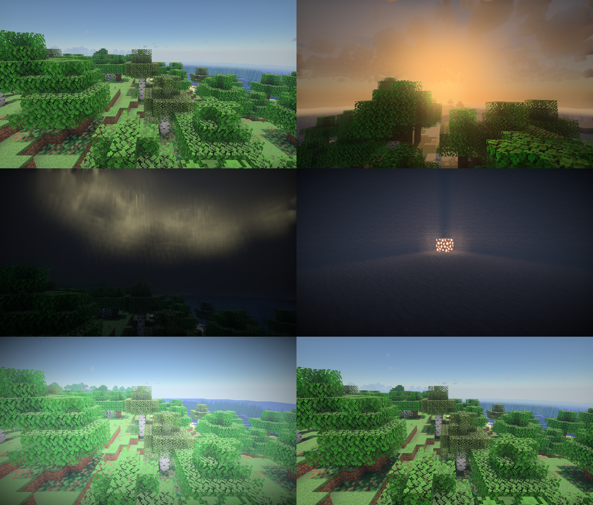
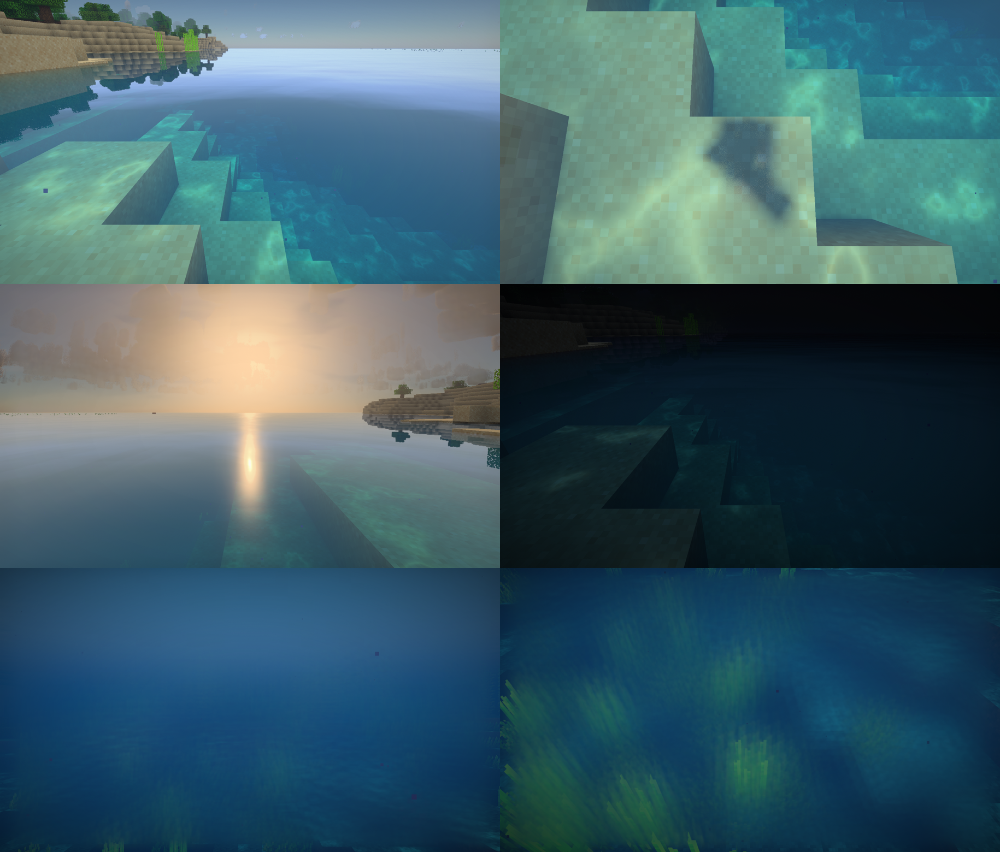
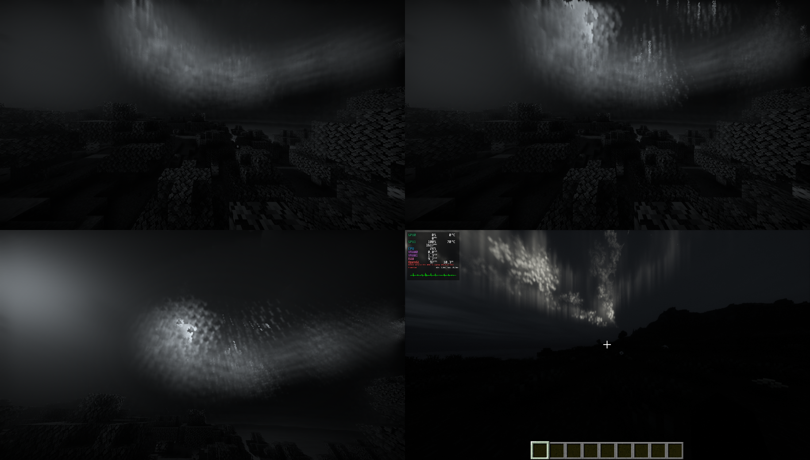

<div align="center">

# Vulpe para Horizon

**Shader para [Horizon](https://github.com/horizon-rust/horizon), el Minecraft Java 26.3 reescrito en Rust: cielo físico, cielo fractal con aurora, niebla volumétrica, agua y luz PBR.**


</div>

---

## Qué es

Vulpe es un shader de Minecraft con aspecto propio: un cielo con dispersión atmosférica real, un
**cielo fractal** que de noche cuelga cortinas de luz dentro de la niebla como una aurora, niebla
volumétrica densa y oscura de noche, nubes con volumen, agua con refracción y cáusticas, menas que
brillan solo en el mineral y un aislamiento de color opcional que deja el mundo casi en gris.

Esta es su versión para **[Horizon](https://github.com/horizon-rust/horizon)**, que tiene su propio
motor y su propia API de shaders en WGSL, por etapas (`sky`, `material`, `vertex`, `weather` y hasta 8
pasadas `post`). No es un port de un pack de OptiFine/Iris: está escrito desde cero para esa API.

<p align="center">
  
  
</p>
<p align="center">
  
</p>

<p align="center"><sub>Capturas del propio pack en Horizon, hechas con <code>tools/probar.sh</code>. En la hoja de la aurora, la imagen de abajo a la derecha es la referencia de la versión para Iris/Oculus.</sub></p>

## Funciones principales

- **Cielo y atmósfera:** dispersión Rayleigh y Mie con tablas precalculadas, sol, luna y estrellas,
  cinturón de Venus al anochecer.
- **Cielo fractal (propio):** conjuntos de Julia y Mandelbrot que cambian cada noche, con paletas.
- **Aurora del fractal:** de noche las figuras emiten luz dentro de la niebla, con cortinas, vetas,
  conos que abren huecos y una ventana al cielo a través de ellos.
- **Niebla y nubes:** un solo raymarch para aire, niebla y tres capas de nubes, con tiempo que cambia
  cada día y horario de niebla (jirones al amanecer, niebla densa de noche).
- **Luz de superficie:** difusa, GGX, LabPBR completo (metales incluidos), SSS en hojas y nieve,
  charcos con la lluvia, luz de bloque con color, estaciones.
- **Sombras:** PCSS con penumbra variable, sombras de color de cristal y agua, sombras de nubes.
- **Agua:** olas, refracción con la profundidad real, absorción, reflejo con el cielo del pack,
  cáusticas, niebla y ventana de Snell bajo el agua.
- **Imagen:** TAA con FXAA, bloom, exposición automática, tonemap, efecto Purkinje, oclusión ambiental.
- **Propias de Vulpe:** menas brillantes, aislamiento de color y rayos del fractal.
- **Otras dimensiones:** niebla y luz propias del Nether y del End.

## Instalación

Necesita **Horizon** instalado con su lanzador ([instrucciones en su repo](https://github.com/horizon-rust/horizon)).
La vegetación ondulante necesita una nightly de Horizon posterior al 2026-11-01 17:17 (UTC+1), que es
cuando entró la etapa `vertex`. Mientras no esté publicada, esa parte va desactivada en el manifiesto.

```bash
git clone https://github.com/noctivulp-ch/vulpe-horizon.git
cd vulpe-horizon
tools/montar.sh                     # arma el pack en build/vulpe/
```

Después, una de estas tres:

- copiar la carpeta `build/vulpe/` a la carpeta `shaderpacks/` de la instancia (junto a `options.txt`)
  y elegirla en el menú de shaders del juego;
- empaquetarla con la herramienta de Horizon, `horizon-shader pack build/vulpe`, y añadir el
  `.hshader` con `horizon-launcher packs add`;
- para probar sin instalar, arrancar con `HORIZON_SHADER_PACK=build/vulpe`. La recarga en caliente
  aplica cada archivo que se guarda.

## Cómo está hecho

- **Sala limpia.** La versión original de Vulpe se apoya en Bliss, cuya licencia no permite publicar
  derivados. Esta versión se escribió con dos agentes separados por una especificación: uno leyó el
  original y describió qué hace cada parte, sin código; el otro escribió este pack solo desde esa
  descripción y la bibliografía pública. Un tercero hizo de gestor y revisó cada lote que cruzaba la
  muralla. Detalle en [ADR 0001](docs/decisiones/0001-sala-limpia.md) y [docs/metodologia.md](docs/metodologia.md).
- **Carpetas por función y SOLID.** `etapas/` solo compone, `nucleo/` son funciones puras sin acceso al
  motor y `adaptadores/` es lo único que conoce la API de Horizon. Ver [ADR 0002](docs/decisiones/0002-estructura-por-funcion.md).

| Capa | Qué hay |
|---|---|
| `etapas/` | puntos de entrada de cada etapa y las 7 pasadas `post`, en orden |
| `nucleo/` | matemática, ruido, color, atmósfera, cielo, volumen, superficie, luz e imagen |
| `adaptadores/` | traducción de la API de Horizon (`frame`, `MaterialInput`…) al núcleo |
| `opciones/` | los ajustes del menú y las constantes con nombre, agrupados por efecto |
| `tools/` | montar, validar y probar en el juego con `horizon-ctl` |

## Progreso y calendario

Empezado el **2026-11-01**. Cifras al 2026-11-02: unas 4 700 líneas de WGSL, 53 opciones de las 64
que admite Horizon.

| Fase | Qué es | Estado | Fecha prevista |
|---|---|---|---|
| 1. Base | los 16 subsistemas especificados e implementados | **hecha** (15 de 16 en marcha; el 15, vegetación, espera la nightly de Horizon) | 2026-11-02 ✔ |
| 2. Faltas | lo que le faltaba frente al original: 10 faltas | **en curso**: 6 de 10 hechas | 2026-11-04 |
| 3. Paridad | mismas salidas que el original, medidas con tablas de prueba y capturas en escenas fijas | **en curso**: inventario y tablas de 01, 02, 03, 05, 06 y 11 | 2026-11-08 a 11-10 |
| 4. Flexibilidad | tantos ajustes como el original: presets que mueven varios parámetros, y un mod nativo para Horizon que pase el resto | por empezar | 2026-11-10 a 11-13 |
| 5. Beta pública | primera versión empaquetada (`.hshader`) | — | ~2026-11-14 |
| 6. Detalles finos | rendimiento, rincones sin ver, ajuste fino con jugadores | — | ~2026-11-20 |

Las fechas son una previsión, no un compromiso: Horizon cambia su API casi a diario.

## Documentación

- [`docs/index.md`](docs/index.md): por dónde empezar.
- [`docs/efectos/`](docs/efectos/): un documento por efecto, con el porqué de cada decisión.
- [`docs/decisiones/`](docs/decisiones/): decisiones de diseño (ADR).
- [`docs/metodologia.md`](docs/metodologia.md): cómo se trabaja (sala limpia, pruebas, criterios).

## Licencia

Código bajo **GPL-3.0-or-later** ([`LICENSE`](LICENSE)). Horizon es un proyecto aparte, con su propia
licencia, y no forma parte de este repo.

## Apoyo

Este proyecto forma parte del trabajo de **NoctiVulp**: herramientas para Linux y Android,
publicadas como software libre. Las compilaciones oficiales y las novedades salen en Patreon.

<p align="center">
  <a href="https://www.patreon.com/cw/NoctiVulp"></a>
</p>

---

<p align="center"><sub>© 2026 NoctiVulp · <b>Powered by AI</b> — desarrollado con la asistencia de Claude, de Anthropic.</sub></p>
